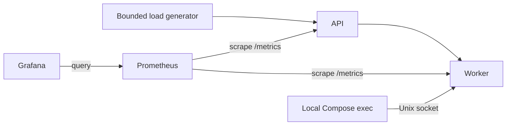

# Agentic Network Ops

A local distributed-services lab for studying infrastructure failures through measured telemetry. Stage 1 implements two Python services, Prometheus monitoring, a provisioned Grafana dashboard, bounded traffic, and one controlled CPU-pressure experiment. Agent-based diagnosis is a later milestone.



The application services share one small image. Each runs a single Uvicorn process; `/work` on the API makes a real HTTP call to the worker, which computes a fixed checksum. Both expose `/health` and `/metrics`.

## Start the lab

Requires Docker Desktop on macOS/Windows, or Docker Engine with Compose v2+ on Linux. Python 3.11+ is needed only for the host demo script; Python and `uv` are needed for local unit tests. No cloud accounts or API keys are required.

Allow about 2 GB of Docker VM memory and two CPU cores as an initial allocation; these are setup estimates, not measured requirements. The four persistent containers have a combined 896 MiB memory limit, plus Docker overhead. Each is capped at 0.5 CPU cores. Images are pulled during setup; the running lab uses an internal Docker network.

```sh
docker compose up --build -d --wait
curl --fail http://127.0.0.1:8000/work
make smoke
```

| Interface | Address | Access |
| --- | --- | --- |
| API health | http://127.0.0.1:8000/health | Localhost |
| API metrics | http://127.0.0.1:8000/metrics | Localhost |
| Prometheus alerts | http://127.0.0.1:9090/alerts | Localhost |
| Grafana dashboard | http://127.0.0.1:3000/d/local-lab | `admin` / `local-lab-only` |

The worker has no published port. Grafana has its data source and dashboard provisioned automatically; log in and open the dashboard link. The password is a public **local lab default**, not a secret. To change it or any published port, copy `.env.example` to `.env` before the first start and edit the values. Grafana stores its initial credentials in its persistent volume.

## Run the incident demo

For an automated baseline → fault → alert → recovery check:

```sh
make check-rules
make demo
# Validation target: repeat the entire experiment three times.
python3 scripts/demo.py --runs 3
```

The script starts bounded traffic, collects a 20-second baseline, injects a 60-second worker CPU fault, checks for `WorkerCpuPressure` firing, waits for natural expiry, and checks both scrape targets, CPU recovery, and alert clearance. It also checks Grafana provisioning and API functionality. It exits with a failure if any required observation is missing. Each run takes roughly two minutes plus setup. Run it alone: concurrent experiments or a manually active fault invalidate the baseline.

Actual observations and ground truth are saved to ignored `artifacts/<experiment-id>.json`, with load output beside them. Detection/recovery times are polling observations, not exact event times. Ground-truth start/end events carry their own UTC timestamps. Three successful repetitions are a target until you run them; this repository does not claim measured incident performance yet.

To explore manually, run traffic in one terminal:

```sh
make load
# Optional: 180 seconds at 10 requests/second, at most 4 in flight.
docker compose run --rm load-generator python scripts/generate_load.py --duration 180 --rate 10 --concurrency 4
```

Then, after about 20 seconds of healthy traffic, use another terminal:

```sh
make inject-cpu-fault       # default: 60 seconds
make fault-status
make stop-fault             # optional early stop; otherwise it expires automatically
```

Watch the CPU, latency, fault marker, and firing-alert panels in Grafana. The default alert evaluates `rate(process_cpu_seconds_total{job="worker"}[15s]) > 0.30` continuously for 10 seconds. At the 0.5-core quota, that threshold represents 60% of the worker's available CPU. Firing is expected within roughly 15–30 seconds of sustained pressure, with several seconds of lag on recovery; these are expectations to verify, not benchmark results. The graph's fault marker is ground truth and is **not** an input to the alert.

CPU usage should rise clearly. Request latency may rise, but a fixed amount of user-visible slowdown is not guaranteed across laptops or Docker VM configurations. The required CPU experiment therefore checks a real **resource-pressure alert**. It does not simulate latency by sleeping or fabricate request metrics. `ServiceUnavailable` and `ApiHighErrorRate` also detect service degradation when it occurs; they are not guaranteed consequences of the CPU fault.

To tune the CPU alert, edit its threshold, `[15s]` rate window, or `for: 10s` in `monitoring/alerts.yml`, update the rule fixtures, run `make check-rules`, and restart Prometheus with `docker compose restart prometheus`. The automated demo assumes the checked-in 0.30-core threshold and 60-second experiment. Short faults may end before the alert can fire.

## What the metrics mean

| Metric | Meaning |
| --- | --- |
| `up{job="api"}` / `up{job="worker"}` | Prometheus successfully scraped that service; not a dependency-readiness probe. |
| `lab_http_requests_total` | Completed application requests by bounded method, route template, and HTTP status. `/health` and `/metrics` are excluded. HTTP 5xx samples are the error count. |
| `lab_http_request_duration_seconds` | Response-completion histogram in seconds; the dashboard computes approximate p50/p95 over 30 seconds. |
| `lab_worker_calls_total` | API dependency outcomes: success, timeout, error, or invalid response. |
| `process_cpu_seconds_total` | Linux process user + system CPU time, including the fault thread in the same PID. Its rate is CPU cores consumed, not a percentage of the host. |
| `process_resident_memory_bytes` | Resident memory of the application process, not total container memory or host memory. |
| `lab_cpu_fault_active` | 0/1 ground-truth scenario marker; worker only is meaningful. |
| `ALERTS{alertstate="firing"}` | Prometheus's currently firing alerts; no series means no firing alert. |

Unknown paths are grouped under `unmatched`; unknown HTTP methods under `OTHER`. Raw URLs, user data, run IDs, and addresses are not metric labels. Idle traffic panels may be empty until requests arrive; latency percentiles are undefined without observations. Request logs are JSON records with timestamps, service, bounded route/method, status, and duration.

## Limits and controls

- Faults are off until explicitly requested. A fault runs in a worker thread for 1–120 seconds, defaults to 60 seconds, rejects concurrent starts, and ends on graceful shutdown. A container-local socket, mode `0600`, accepts controls through `docker compose exec`; there is no fault HTTP endpoint. Fault control refuses to start outside Docker.
- The worker's 0.5-core CPU and 192 MiB memory limits bound its resource use. There are no privileged containers, Docker socket mounts, host process mounts, or host network mode. Project monitoring files are mounted read-only; data uses named volumes.
- Load targets the fixed `http://api:8000/work` address, follows no redirects, and accepts no external target option. Defaults are 120 seconds, 10 requests/second, and four in-flight requests; hard caps are 600 seconds, 50 requests/second, and eight in flight. Slow requests cause skipped sends rather than an expanding queue. Requests have a three-second timeout and may finish just after the generation deadline.
- API calls have a two-second downstream timeout, a 0.5-second connection timeout, bounded connections, and no retries. Worker failures become 502 responses; timeouts become 504. `/health` only reports process liveness.
- User-facing ports bind to `127.0.0.1`. The internal network isolates outbound container traffic. These controls describe a local development lab, not a production deployment.
- Scenario events persist at `/var/lib/lab/scenarios.jsonl` in the worker volume and also appear in worker logs. Abrupt container termination can leave a start event without an end event; treat that run as interrupted. Docker logs rotate, but scenario history remains until explicitly removed.

```sh
docker compose logs --tail 100 worker
docker compose exec -T worker cat /var/lib/lab/scenarios.jsonl
docker compose down         # keep metrics, Grafana state, and scenario history
docker compose down -v      # explicitly delete all lab volumes and recorded history
```

## Development and validation

```sh
uv sync --frozen
make test
make lint
make check-rules            # requires Docker; native promtool also works (below)
```

Application and development dependencies are resolved in `uv.lock`; Docker installs the hash-pinned runtime export in `requirements.txt`. After intentionally updating the lock, refresh that export with:

```sh
uv export --frozen --no-dev --no-emit-project --format requirements-txt --output-file requirements.txt
```

Container images use explicit version tags, not immutable digests. Lock files pin Python artifacts; image tags can still be republished upstream.

Tests cover real API-to-worker ASGI requests, downstream failures, HTTP instrumentation, label bounds, fault duration/stop/expiry behavior, the Unix control protocol, and load parameter limits. Fault unit tests use a substitute burner or a simulated clock; they do not stress the host. Prometheus fixtures test healthy, firing, recovery, and short-burst cases:

```sh
promtool check rules monitoring/alerts.yml
promtool test rules monitoring/rules.test.yml
```

See [validation notes](docs/validation.md) for checks actually executed and remaining Docker verification. On native macOS, the Python client's Linux process metrics are absent. Run the full demo in Linux containers, including Docker Desktop's Linux VM; it measures those application processes, not the Mac host. Node Exporter and cAdvisor are deliberately not dependencies. No packet-loss, security detection, agent diagnosis, or remediation capability is implemented yet.

Further design details: [architecture](docs/architecture.md). Next milestones: [roadmap](docs/roadmap.md).

## Troubleshooting

- `docker: command not found` or daemon unavailable: install/start Docker Desktop or Docker Engine + Compose, then retry the startup command.
- A port is in use: set a different port in `.env`, recreate the containers, and use the new localhost URL. The automated demo reads effective Compose port mappings.
- Dashboard empty: run traffic and allow at least 30 seconds of scrapes; check Prometheus targets at `/targets` and confirm both report UP.
- CPU alert does not fire: inspect worker logs, its CPU time series, the fault marker, and scrape availability. Check Docker VM CPU allocation and avoid competing workloads. Preserve the failed demo report; do not treat missing CPU metrics as recovery.
- Grafana login fails after changing `.env`: the existing volume retains its prior password. Use the old login or reset it through Grafana's supported administration tools. Removing volumes also resets it but deletes lab history.
